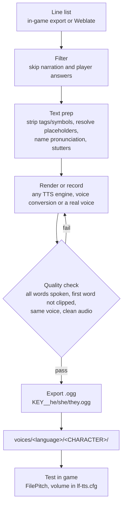

# Voice packs – how to make your own

The plugin is only a player: it plays audio files it finds by name. Any voice pack – rendered with any
TTS engine, voice-converted, or recorded by a real person – works as long as it follows this layout.
You can also replace single lines of an existing pack.

## Production at a glance



## Folder layout

```
<game>/BepInEx/plugins/LethalFantasyTTS/voices/en/
    AKIPO/<KEY>.ogg
    RED/<KEY>.ogg      (Solana, the red twin)
    BLUE/<KEY>.ogg     (Selena, the blue twin)
```

- `en` = the language of the lines. Other languages use their own folder (see
  [Voice packs in other languages](#voice-packs-in-other-languages)); lines missing there fall back to `en`.
- The folder is the **speaker**. Some lines can be spoken by either twin; put the file in the folder
  of the twin who should say it (or in both).

## File names

`<KEY>.ogg` – `KEY` is the line's **translation key**, exactly as the game uses it (the same IDs as
on the game's translation site), e.g.

```
AKIPO/AKIPO_DIALOGUE_GROW_START2_8.ogg
RED/REDTWIN_DIALOGUE_HOUSE_DEATH_FAILURE_2_1.ogg
BLUE/BLUETWIN_DIALOGUE_TITLE_RANDOM_22_1.ogg
```

**Identity variants:** lines containing `{they}` / `{them}` / `{they're}` change with the player's
chosen identity. Make one file per variant:

```
<KEY>__he.ogg     <KEY>__she.ogg     <KEY>__they.ogg
```

The plugin first looks for `<KEY>__<identity>.ogg`, then for `<KEY>.ogg`.

## Audio format

- **Ogg Vorbis** (`.ogg`) – the only format the plugin loads.
- Mono recommended (the plugin plays it in 3D at the character's mouth). Any sample rate works;
  44.1 or 48 kHz is fine. Quality `-q:a 5…6` is plenty.
- Keep a short silence (~0.1–0.15 s) at the start so the first word isn't clipped; trim long trailing
  silence or breaths.
- Normalize loudness across the pack so lines don't jump in volume.

Example conversion: `ffmpeg -i line.wav -ac 1 -c:a libvorbis -q:a 6 KEY.ogg`

## Getting the list of lines

The game's text belongs to its author and is not distributed with this mod, but you can export the
line list from **your own copy** of the game:

1. In `BepInEx/config/lf-tts.cfg` set `[Developer] ExportLines = true` and start the game once.
2. It writes to `<game>/BepInEx/LethalFantasyTTS/`:
   - `english_lines.jsonl` – every key and its English text (`{"key": ..., "text": ...}`; raw text
     with `{they}` placeholders and rich-text tags such as `<i>`),
   - `dialogue_events.jsonl` – for each dialogue line: key, speaking character, line type and the
     facial expression (useful as an emotion hint).
3. Set `ExportLines` back to `false`.

Strip rich-text tags (`<color=...>`, `<i>`, …) and symbols like `~` before speaking a line.

## Voice packs in other languages

The plugin plays the folder of the game's current language first and falls back to the English pack
line by line, so a new language pack can start small and grow.

| Game language | Folder |
|---|---|
| English | `voices/en/` |
| Hungarian | `voices/hu/` |
| Japanese | `voices/ja/` |
| Chinese | `voices/zh/` |
| Spanish | `voices/es/` |
| French | `voices/fr/` |
| Portuguese (Brazil) | `voices/pt-BR/` |
| Russian | `voices/ru/` |

Inside it the layout is the same as for English: `AKIPO/`, `RED/`, `BLUE/` (and `STORY/` for the Memory
Orb audiobook), files named `<KEY>.ogg`, e.g. `voices/hu/AKIPO/AKIPO_DIALOGUE_IDLE_CRAFTING_HINT_1_1.ogg`.

### 1. Get the translated lines from the game's Weblate

All of the game's text is translated by the community on the official Weblate:
<https://lethalfantasy-translation.com/projects/lethal-fantasy/#languages>

1. Open the link, pick your **language**.
2. Open a **component** (the game's text is split into components such as dialogue groups, idle lines,
   affection, story, …). The **Akipo / Red Twin / Blue Twin** dialogue components are the spoken lines.
3. Download it: **Files → Download translation** (CSV or PO).
4. In the file, the **key / context** column is the translation key = your file name; the translated
   text is what you voice. Weblate's **source string notes** (shown on each string) describe the
   scene and are great acting hints.
5. Repeat for the components you want to voice.

Notes:

- Check the translation state per component first: untranslated strings show the English source text
  (the game would show English there too), and strings may still change before a release.
- The in-game export (`ExportLines`, see below) gives you the **speaker** and the **facial expression**
  of every dialogue line (`dialogue_events.jsonl`); the key is the same in every language, so you can
  join it with the Weblate text to know which character says what and how.
- `{they}` placeholders: make `__he` / `__she` / `__they` variants with your language's words for the
  three identities, or one file without the identity word if your language allows it.

### 2. Make the audio

Any way works – the plugin does not care how the file was made:

- **Record it yourself** (or with friends) – the most characterful option.
- **A TTS engine that speaks your language.** Open models exist for many languages (for example Kokoro
  covers Japanese, Chinese, Spanish, French and Brazilian Portuguese). Check each engine's license and
  its voice/model license before you share audio made with it.
- Keep **one fixed voice per character** for the whole pack (same reference/voice settings for every
  line), and change only the acting with the emotion.
- Pronounce the names consistently (Akipo, Solana, Selena); write them phonetically for the TTS if it
  gets them wrong.

Then convert to `.ogg` with the right file names (see *Audio format* above) and drop the files into
`voices/<language>/<SPEAKER>/`. Start the game in that language – lines with a file speak your language,
the rest stays English.

### 3. Share it

Packs speak the game author's lines, so ask the game's author before publishing (see *Sharing packs*).
A language pack should keep the same folder layout so players can simply unzip it into the game folder.

## What not to voice

- The player's own answers and choices (keys ending in `_Q`, `_Q_A`, …) – the player character is
  never voiced.
- Narration (`_S` keys, line types `StoryDialogue` / `StoryPoise`).

## Tuning in game

Per character in the `.cfg`, `[Voice.English.<Character>] FilePitch` (used for the voice files of every
language) changes the playback pitch of the
files (e.g. `0.95` = slightly deeper; it also slows the tempo slightly). Volume and all 3D effects
apply to every pack.

## Sharing packs

Voice packs speak the game author's lines, so they are derived from the author's work: only publish a
pack if the game's author allows it. Packs for personal use are fine.
